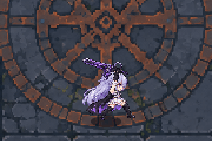
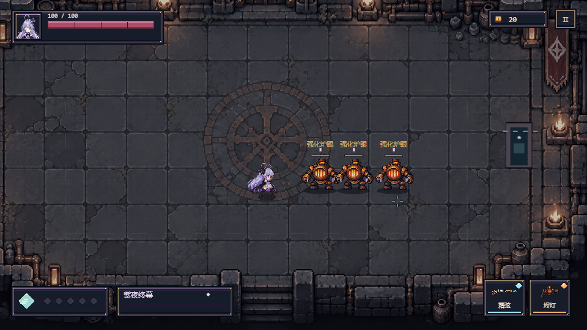
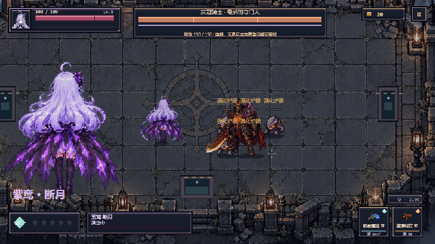

# 灰烬回廊

**[▶ 点击试玩灰烬回廊](https://chenxigao88-collab.github.io/-----/)**

**紫鸢 · 枪斗连招**



**紫鸢 · 大招「紫夜终幕」**



**紫鸢 · 双层大招「紫鸾·断月」**



原创HTML5俯视动作Roguelite，当前版本 **0.11.1 · 巨月断空**。35个连通房间、三个区域、局内1–12级三选一成长、六处陷阱房、七种普通近战／辅助敌人，以及三阶段Boss「灰冠骑士」。剧情跟随区域推进，营地支持保存和继续旅程。两名角色的逐段枪斗、五元素十反应、三槽符印、可爱休息动画和紫鸢双层大招完整保留。

0.11.1重绘24帧石质巨月与鸾翼，终幕改为一轮巨大悬月、一刀劈开、一次整体崩解；怪物只保留34像素羽印与48像素细裂痕。巨月与翼展位于人物背后，紫鸢保持前景，镜头缓慢拉远并固定终幕构图。见[巨月演出与素材提示词](docs/VIOLET-MOON-COLOSSUS-ART.md)。

0.11为紫鸢加入第二大招「紫鸾·断月」，能量现在可积攒两层，每层100。R消耗一层发动紫夜终幕，保留剩余能量；Shift+R消耗两层，演出5.5秒：回眸双月环、装备双武器满蓄力开火、三段穿阵留裂痕、紫色鸾翼展开、收剑后统一断月爆发。新增24帧角色动作和24帧透明绘制特效；Boss不受挑飞与牵引。见[机制、数值与素材提示词](docs/VIOLET-MOON-ULTIMATE.md)。

0.10为24把武器加入独立绘制外观，手持、配装、掉落比较与HUD同步使用。九类弹体、枪口、蓄力、普通挥刀、右键刀光、爆炸、命中碎片、火场与导流电弧均改用透明PNG素材；十种反应各有八帧动画。战斗美术通过图片裁切、旋转和合成播放，数值信息条仍保留。见[素材、提示词和接入说明](docs/PAINTED-COMBAT-0.10.md)。

0.9将24把武器分成九种实际打法：灰针连续射击加速、岩屑散弹、三发依次连射、蓄力增弹数的霜弦、蓄力扩爆炸的烬灯、持续追踪电弧与过热、蓄力增单发伤害的重弩、积剑势发剑气的缄锋、飞出再返回的环刃。弹体、尾迹、枪口和合成音色分别设计；按住左键蓄满自动射击，松开提前发射，蓄力不减移动速度。两角色右键连招和紫鸢大招直接使用满蓄力，满势烬灯也发射真实火球。每波普通怪增一只，普通与精英生命提高15%，攻击和出手名额保持。当前规则见 [0.9武器设计](docs/WEAPONS-0.9.md)，[九类弹体实机画面](artifacts/weapon-mechanics-preview.png)。

0.8新增前中后期24把武器（6／9／9），包括疾风连铳、镇岩重弩和回风环刃新族；各区域首次清场、每两场普通战斗、精英与秘藏提供武器，普通敌人也有小概率掉落。每级攻击+8%，锋芒+20%，枪斗／巨刃+25%，元素亲和+35%；反应采用基础值＋武器基伤系数，并继承角色成长。敌人生命与少量护甲随深度增加，玩家输出增长更快。武器比较显示实际成长伤害和提升比例，HUD显示阶段与每弹伤害。完整数值和机制见[0.8数值设计](docs/BALANCE-0.8.md)。

沿用第一章探索路线，实际时长随配装、打法、阅读和探索支路变化。0.8加强成长后，两角色自动无敌攻击夹具战斗时间约10分钟，不能视为真人通关时长，旧0.7半小时编排计时不再代表当前平衡。剧情和存档规则见[第一章说明](docs/CHAPTER-0.7.md)，成长、兵装与反应数值以[0.8说明](docs/BALANCE-0.8.md)为准，新素材及实际提示词见[第一章美术](docs/CHAPTER-ART-0.7.md)。

战斗页使用像素血条、等级与经验、小地图、双武器和大招能量；暂停可查看数值、强化和遗物。营地首次进入回复25生命，刷新后可在启程页点击“继续上次旅程”。死亡、通关或重新启程清除本局存档。

升级可选择「锋芒」「枪斗专精」「元素亲和」提升攻击、大招与对应反应；紫鸢「巨刃专精」每档刀击+25%，最多3档，包含所有阶段近战武器。枪斗专精作用于连招和大招，元素反应也继承通用与枪斗增益；紫夜终幕末刀按前段实际伤害70%结算，紫鸾断月按枪击与三道裂痕实际伤害120%追加终击。旧营地存档保留，新增巨刃等级从0开始。

新增可选角色「紫鸢」：巨刃下劈、上挑、回旋击飞、单膝两枪、回身换枪第三枪，六次右键逐段触发。三枪自动锁定最近敌人，跪射两枪可追击空中目标。九张透明图集172帧，侧向八帧跑步、待机、闪避、受击与倒地均已接入，长发与披风逐帧摆动。开战前在角色与双武器界面选择，刷新与重开保留；原角色「余烬」仍可选。详见[角色与素材说明](docs/VIOLET.md)，[跑步预览](artifacts/violet-running-fixed.gif)、[击飞预览](artifacts/violet-launch-fixed.gif)。

紫鸢近战新增专属紫色绘制刀光：下劈、上挑、回旋与普通月牙斩各六帧，共24帧，覆盖左键近战、右键三连刀、剑气与大招刀斩。见[实机预览](artifacts/violet-melee-preview.png)、[素材与提示词](docs/VIOLET-MELEE-ART.md)。

## 开始游玩

十种元素反应均已加入独立八帧像素动画，共80帧，覆盖起势、爆发、碎片扩散和消散。灼烧、熔痕、冰缚有跟随敌人的残留动画，导流有跟随三目标位置与击飞高度的动态电弧。见[特效预览](artifacts/reaction-animations.gif)、[规则与素材说明](docs/REACTION-ANIMATIONS.md)。

在本目录双击 **开始游戏.cmd**。它启动本地服务并打开浏览器，保持命令窗口开启；关闭窗口或Ctrl+C结束服务。当前机器已具有Node运行时与构建产物，不需要先安装依赖。

若灰烬回廊服务已经启动，再次双击会复用现有服务并打开游戏。首次交付已启动本地试玩地址。重复打开的窗口不拥有原服务，不会因关闭而结束原服务。

也可执行`node scripts/serve.mjs`，打开`http://127.0.0.1:4173/`。若端口被其他程序占用，先关闭旧服务，或指定`ASH_PORT`。游戏是本地静态页面，不需要账号、联网或后端。

## 操作

| 操作 | 按键 |
|---|---|
| 选择角色与双武器 | 启程前点“角色与武器” |
| 开始冒险、过门、开箱、查看商店 | 靠近对应位置按E |
| 移动 / 瞄准 | WASD / 鼠标 |
| 普通攻击 | 按住左键 |
| 枪斗连招 | 右键每按一次接一段；余烬五次、紫鸢六次；段间0.45秒，Space可主动中断 |
| 短闪避 | Space，有方向输入时按方向闪避，无方向输入时向瞄准反方向短撤 |
| 手动调整换持 | Q，成功后冷却3秒，不消耗枪斗势；右键连招和大招换持不受此冷却限制 |
| 紫鸢第一大招「紫夜终幕」 | R，消耗一层100能量，保留剩余能量 |
| 紫鸢第二大招「紫鸾·断月」 | Shift+R，需要两层全满，消耗200能量 |
| 暂停 / 继续 | Esc，失焦也会暂停 |
| 调试面板 | F2 |

首次默认灰针＋砾钟。开战前可从灰针、砾钟、缄锋、霜弦、烬灯、鸣枝中选两把，选择保存在当前浏览器，重开仍保留。配装界面展示元素反应与两把武器的强化终结；F2换武器是临时调试，不覆盖正式配装。

连招需要五次独立右键，按住不会自动推进。段间衔接窗口0.45秒，段末0.12秒可预输入下一段，最多缓存一段；超时结束，腾空动作安全落地。空房间也能练习。空中用当前武器开火一次，第五次输入落地旋身后拔副武器再开火一次并保持换持。四次近身接触各有判定时点，两枪共享一次枪斗势奖励。Space或地面受击会打断。完整规则见[手动枪斗连招](docs/GUNFU-MANUAL.md)。

右键连招在各自开火时点自动瞄准最近的存活敌人，身体和枪口同步朝向目标；弹丸保留装备武器的速度、射程、散布与穿透，可能因移动、距离或遮挡打空。装备缄锋时对应段改为近战挥斩，按实际范围命中，不替换成枪。第一枪击杀后，下一次攻击重新选敌。没有敌人时沿鼠标方向空放。普通左键继续由鼠标瞄准。大招同样使用装备的真实弹丸或近战动作。

短闪距离约56像素，冷却0.9秒。按下闪避后0.5秒内被攻击命中判定，会挡下触发的一击并暂停敌方动作2秒，玩家仍能移动和反击；时停期间不能刷新时长，结束后有0.12秒恢复过渡。怪物分别采用横扫、侧翼扑击与重型砸击，区域精英为720基础生命并按深度成长，炉心由灰冠骑士守护。完整战斗基础规则见[六式枪斗说明](docs/GUNFU-0.4.md)。

前半段敌人一次只由一只出手，后区最多两只且起手错开，其他敌人半速绕行；攻击后有恢复和观察时间，精英第二击也能通过撤离范围避开。具体参数见[敌人进攻节奏](docs/ENEMY-PACING.md)。

元素印记仍持续5秒，异元素直接命中触发对应反应，每只怪物反应间隔1.2秒。持续效果较长、硬控较短，硬控结束后有2秒保护。当前十反应的伤害公式与控制见[0.8数值设计](docs/BALANCE-0.8.md)；[元素版本说明](docs/ELEMENTS-0.2.md)仅保留历史设计。

人物身体按移动或短闪方向朝向，停止后保持最后朝向，武器独立跟随鼠标；待机采用固定站姿做轻微上下呼吸。枪斗动作包含贴身打击、滑步、拔出副武器与反击的分段表现；动作表现与伤害时点同步。怪物按身体轮廓设置受击范围，F2的碰撞显示可查看实际范围。

本轮使用内置图片生成功能新增128帧四方向动作，含真实倒置的后空翻、伸腿踢击和落地旋身。查看[实机动画](artifacts/26-gunfu-routine.gif)、[36帧分解](artifacts/26-gunfu-routine-frames.png)及[原图与实际提示词](docs/GUNFU_ART_0.4.md)。

## 开发

技术：TypeScript strict、Vite、Canvas 2D、HTML/CSS HUD、Vitest，无游戏运行时框架。建议Node版本满足当前lockfile依赖要求。当前实际安装Node24.19.0、Vite8.3.2、TypeScript7.0.2、Vitest5.0.3，版本由pnpm-lock.yaml锁定。

```text
pnpm install --frozen-lockfile
pnpm dev
pnpm typecheck
pnpm test
pnpm build
pnpm preview
```

若环境没有pnpm，可使用npm安装并运行同名脚本；应保留实际使用的lockfile，避免两种管理器交替改依赖。项目已安装的依赖也可直接以Node运行`node_modules`中的Vite/TypeScript/Vitest入口。

## 目录

```text
src/core/          应用、输入、时间、固定步长、事件和值类型
src/actors/        玩家、敌人、组合组件的实体、共用状态机
src/combat/        武器、伤害、子弹、近战、枪斗连招、元素与区域技能
src/room/          战斗波次、九房探索、宝箱、金币与商店交易
src/data/          玩家、武器、敌人、波次、共鸣与手感数据
src/rendering/     PNG图集加载、身体动画、渲染与特效
src/feedback/      手感、合成短音效
src/ui/            HUD、配装、暂停/结果、Debug
public/art/        透明角色和武器图集、房间背景、元数据
tests/             战斗、时间、波次、生命周期与自动战斗测试
scripts/           本地服务、资产索引、浏览器验证
docs/              架构、扩展、进度、素材与生成记录
artifacts/         实际游戏截图和浏览器/性能报告
dist/              已构建的静态运行版本
```

系统说明见[架构](docs/architecture.md)，新增内容见[扩展指南](docs/extension-guide.md)，完成度与限制见[PROGRESS](docs/PROGRESS.md)。实际验证结果见artifacts的JSON报告和docs/VALIDATION.md。

## 当前边界

这是第一章可玩原型。地图连接关系固定，障碍布局、普通敌人组合与奖励在开局生成，本局返回保持；已接入三阶段独立Boss「灰冠骑士」和营地跨刷新存档，尚无永久属性树。浏览器保存行前角色和配装，有营地存档时可选择继续上次旅程。素材是原创AI生成的像素候选并已按透明图集接入，武器和身体分开绘制。敌人的完整四方向动画、专门受击帧及人工逐像素清稿仍可继续完善。经济和符印强度还需结合人工试玩调整。Boss招式、破韧与Q切换冷却见[Boss设计与接入](docs/BOSS-DESIGN.md)。

世界缓冲960×540，默认整数倍显示。1920×1080为2倍，1280×720为1倍居中；更小窗口会等比缩小。尚未承诺所有系统缩放比例的物理像素完美，视觉验收与具体差异见文档。

紫鸢连续站立8秒后会坐下、打盹，再侧躺休息。移动、射击、连招、闪避、交互和受击会立即打断，暂停不推进待机时间。开启宝箱后显示金币和实际回血数量，选定符印后提示获得的名称。

精准闪避采用宽容危险判定：闪避后0.5秒内，敌人攻击范围擦过角色周围60像素也能触发，出手前最后0.25秒的预警同样有效。实际伤害碰撞箱不变，远处或隔着障碍的攻击不会触发。

紫鸢的长待机表演按次轮换：第一套蹲下比出手枪手势，左右瞄准、眯眼笑，起身背身走小猫步；下一次为坐下打盹、侧躺休息。猫步仅产生轻微画面摆动，不移动实际位置，不发射子弹。任意操作立即打断。

紫鸢大招「紫夜终幕」：命中、连招末枪、元素反应、闪避时停和击杀积攒能量。满100能量后，朝敌人瞄准并按 R，锁定前方最多5名敌人，演出约4.8秒，包含巨刃挑起、回旋聚拢、双元素枪击与终击。镜头放大、24帧512×512特写、48个新全身动作姿势和32帧刀光/终击/枪口特效已接入。详细规则见 docs/VIOLET-ULTIMATE.md，人设图见 docs/紫鸢-人设图.png。

