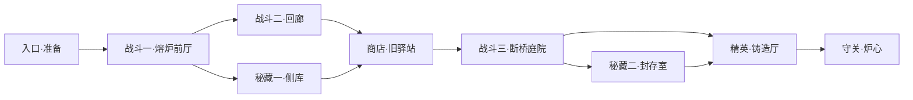

# 灰烬回廊：界面、探索与奖励设计草案

2026-10-05。讨论稿，未修改游戏行为。基于当前双武器、手动枪斗连段、精准闪避时停、五元素十反应和两名角色设计。

**这一版希望形成的体验**

进入炉室 → 用连招清场 → 收金币、开宝箱 → 在分岔处选择探索路线 → 到商店补给或完善构筑 → 挑战守关敌人。战斗仍以玩家逐段输入、观察敌人和闪避反击为中心。第一版做一个完整小章节，目标首次游玩约12—18分钟；实际时长通过试玩调整。

**界面与美术**

GUI采用黑曜石底板、旧铜边框、紫色晶石和少量暖金高光。边角使用像素切角与铆钉，保持清晰的硬边，装饰只留在外沿。头像与角色图集统一；余烬用暖色点缀，紫鸢用紫色点缀。所有界面按同一逻辑像素网格制作，以整数比例缩放，避免模糊边缘。

| 位置 | 显示内容 | 行为 |
| --- | --- | --- |
| 左上 | 小头像、血条、当前/最大生命 | 受伤时残余血量拖尾约0.35秒；低血量轻闪边框 |
| 右上 | 金币图标与数字、小地图、暂停图标 | 小地图只画已到达房间和已发现出口；标出已见宝箱、商店 |
| 左下 | 短闪图标、五颗枪斗势晶石 | 短闪用遮罩表现恢复；每颗晶石对应20势，充满后边缘发亮 |
| 右下 | 两个武器格、武器像素图、元素角标 | 当前武器描金边；换持闪一次；技能有独立冷却遮罩 |
| 战斗中临时出现 | 连段节点、接段窗口、交互按键 | 余烬五个输入节点，紫鸢六个；仅连招期间显示，不把自动收势算成玩家输入 |

移除常驻操作说明、反应说明、连招动作名称、精确倒计时、调试按钮、版本号和战斗页品牌文字。操作说明进入暂停页；物品解释保留在选择面板。F2快捷键保留。第一次遇到新操作时可显示一次短提示。时停以画面变化和晶石闪光表达。

武器格不显示弹药数，现有武器没有弹药资源。冷却与枪斗势使用不同形状，避免误读。购买价格、生命数字和物品的一句功能说明仍保留，它们影响玩家决策。

**宝箱**

| 类型 | 外观与奖励 | 获取方式 |
| --- | --- | --- |
| 铜扣战利箱 | 矮木箱、旧铜角；金币，偶尔少量恢复 | 普通战斗清场后出现，不弹选择页 |
| 晶封秘藏 | 黑紫箱体、发光晶锁；三选一符印 | 两个支路秘藏室各一个；选择时暂停战斗 |
| 锁链挑战箱 | 暗红锁链、可见封印；额外符印或金币 | 后续扩展：主动接受一场加战才能开启，进入房间不自动触发 |

靠近按E打开，不要求额外长按。约8帧表现解锁、箱盖抬起、光芒收束和物品升起。开过的箱盖保持打开。金币落地有短跳动，符印悬浮等待选择；奖励结算与动画分开，不能因再次交互重复发放。第一版先制作前两种宝箱。

掉落武器仍只占两个槽位。选择替换A或B，旧武器放回地面供本房间内换回；被换下的武器不能反复售卖换钱。选择面板明确展示替换后能够触发的元素反应。第一版不加入随机词条和武器强化等级，优先保证两把武器的搭配价值。

**金币与商店**

金币仅属于本次冒险。开局20枚；普通房间总收益约22—30枚，包含敌人掉落和清场战利箱；秘藏室另有15—20枚；精英房约35—45枚。敌人每次掉少量金币，用不同大小的币表示面值，避免满地几十个对象。

战斗中近距离自动拾取，清场后本房间金币自动汇集到玩家。金币只在首次击杀、首次清场和首次开箱时生成，反复进出不刷新。地图不因掉落位置难到达而损失主要收益。

商店设在安全房，由披短斗篷的炉室行商经营；摊位上直接摆出可买物品，靠近按E查看。商品名称、价格、功能一句话与购买按钮组成小面板。初版固定三个货位，存货在本次冒险内不刷新。

| 货位 | 初始价格 | 内容 |
| --- | --- | --- |
| 恢复药 | 25金币 | 回复25生命，限购一份；满血时禁止购买 |
| 符印 | 40—50金币 | 优先提供当前角色、武器组合可用的未拥有符印 |
| 武器 | 45金币 | 一把未装备的武器，展示替换槽位和元素搭配 |

抵达商店时预期约60—100金币，可以选补给加一项构筑，或省钱回头买武器。购买武器时只在最终确认替换后扣费。第一版没有免费刷新、重复卖出、永久数值升级；价格是试玩起点，尚未通过完整章节验证。

**相连的箱庭地图**

第一章使用九个房间。每个房间先沿用当前960×540逻辑尺寸，通过实体门和短走廊连接；房间布局分别设计柱子、掩体、窄口和开阔区域。连接关系遵守实际方位，不使用地图传送菜单。两个支路秘藏室允许往返，商店是中途的安全汇合点。

图中箭头表达冒险推进，已清场门允许双向通行。普通战斗房一到两波；精英房强调站位与完整连招；守关先使用现有精英敌人的独立配置和更明确的场地设计，完整Boss留作后续扩展。

进入战斗区前展示门上的敌人图标，越过门后有短暂准备时间。开战封门，清场打开。清过的房间不复活敌人；箱子、商店库存、破坏物和门状态保持。跨房间保留生命、枪斗势、武器、符印以及实际剩余冷却和状态时间，切换过程不提供免费恢复或刷新。用过的房间安全返回，减少重复赶路。

第一版使用这个固定连接图和少量手工房间模板，随机更换房间布局、敌人组合和奖励；后续才扩成具有分岔和回环约束的随机图。先验证整个探索循环。

**让奖励改变打法**

局内最多装备三个符印。同名符印不叠加，奖励池避开已拥有物品；满槽时可比较替换，替换没有金币收益。按角色筛选专属效果，确保抽到的内容能实际使用。先做约六个符印，控制可测试组合数量。

| 示例 | 改变的选择 | 初始效果 |
| --- | --- | --- |
| 紫鸢·追猎印 | 击飞后接跪射，或先调整站位 | 每次回旋击飞后，第一发命中空中目标的枪斗射击伤害增加20%；每段回旋最多触发一次 |
| 余烬·落火印 | 完成空中射击后继续接旋身终结 | 空中射击命中后，该次旋身终结对同一目标伤害增加20%；不得跨连招储存 |
| 回锋印 | 精准闪避后快速贴身反击 | 闪避成功后2秒内，下次连招第一段命中额外获得5点势；一次时停只触发一次 |
| 融流印 | 挑选适合聚怪的元素组合 | 元素反应范围增加10%；单体反应改为伤害增加10%，不延长硬控制 |
| 终响印 | 追求完整连段而非只用起手 | 最后一枪命中后补一道20%伤害的短残响，不附元素、不累计势、不再次触发符印 |
| 护烬印 | 以连招完成后的短保护继续接战 | 有效终结命中后获得8点护盾，持续3秒；触发后冷却8秒，不叠加，无无敌效果 |

上述射击倍率只作用于对应射击本身，不放大全套连招或反应伤害。复制伤害不再次触发元素、符印或势奖励。角色专属符印需要在各自的攻击频率下分别试玩；第一章优先把组合后的常态输出增幅控制在约25%以内，优势更多来自条件满足与站位。

**值得一起讨论的玩法**

最推荐先加入两种探索反馈。其一是每个战斗房一个可击退的熔炉机关：把敌人推向炉壁能造成少量额外伤害，随后机关冷却，玩家也需避开炉壁的喷火预告。攻击反馈使用现有击退与击飞，环境伤害不产生势或额外元素反应。其二是清场时的风格额外奖励：本房间有效终结、元素反应、精准闪避各首次完成获得2金币，单房最多6金币；普通奖励照常发放，不要求无伤、不允许刷取。

两者分别提高站位价值和鼓励尝试已有动作。锁链挑战箱可以在第二阶段加入，提供自选风险；暂时不同时堆入锻造、抽奖、多币种和永久属性树。

**美术清单与实施顺序**

美术需要：GUI边框与头像框；五元素角标、枪斗势晶石和短闪图标；两种宝箱各约8帧开箱及闭合/打开静帧；金币约8帧旋转；商店NPC待机与招手；摊位；四向门的关闭/开启状态；九房共用的地砖、墙角、柱子、掩体与少量房间特色装饰。后续再补锁链箱和炉壁机关。

箱子用统一64×64帧格，NPC用统一96×96帧格，金币用16×16帧格。素材验收按同类固定显示比例、固定脚点、完整外轮廓和碰撞体位置对齐；箱盖打开与披风摆动不得改变整体显示比例。图集包含精确帧索引与锚点，先预览动作再接入。

建议分三步交付：①清理文字并完成像素GUI；②九房探索、持久房间状态、金币、两类宝箱与三个货位的商店；③六个符印、环境机关和风格奖励。每步都保留两名角色的既有连招、必中射击、击飞和元素反应，再验证房间切换、奖励只领取一次、商店扣费与替换，以及整章难度和经济。
